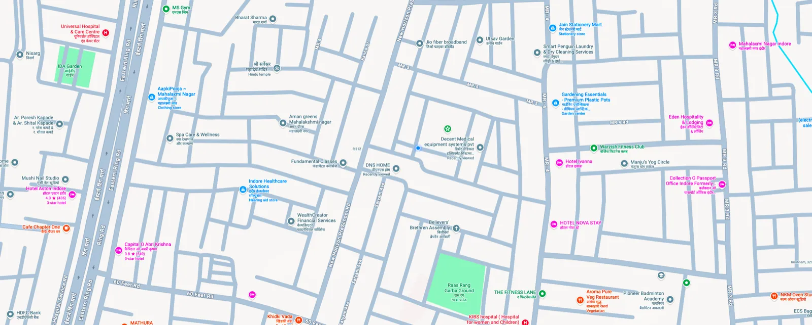

# Bento Portfolio

<div align="center">
  
</div>

<div align="center">
  <h3>
    <a href="https://bento-portfolio-lilac.vercel.app">Live Demo (Vercel)</a>
    <span> | </span>
    <a href="https://github.com/shubhktr1012/bento-portfolio">GitHub Repository</a>
  </h3>
</div>

---

## Overview

A modern, responsive personal developer portfolio featuring a customizable bento grid canvas, live YouTube Music playback integration, dynamic dark mode switching, and performance optimizations.

---

## Core Engineering Features

* **Interactive Bento Grid Canvas:** Fluid responsive layout powered by `react-grid-layout` with draggable and customizable card containers.
* **Live Music Integration:** Endpoint syncing directly with YouTube Music InnerTube session tokens to stream currently playing and repeat tracks in real time.
* **Component System & Theming:** Custom UI system built on HeroUI and Tailwind CSS with smooth transitions and persistent light/dark mode preference via `next-themes`.
* **Telemetry & Vitals:** Instrumented with Vercel Analytics and Speed Insights for real-time Core Web Vitals monitoring.

---

## Tech Stack

* **Framework:** Next.js 15 (App Router), React 19, Turbopack
* **Styling:** Tailwind CSS, HeroUI, Framer Motion
* **Layout Engine:** react-grid-layout
* **Type Safety:** TypeScript
* **Deployment:** Vercel Edge Network

---

## Local Development

1. Clone the repository:
```bash
git clone https://github.com/shubhktr1012/bento-portfolio.git
cd bento-portfolio
```

2. Install dependencies:
```bash
npm install
```

3. Launch development server:
```bash
npm run dev
```

4. Open `http://localhost:3000` or visit the live deployment at `https://bento-portfolio-lilac.vercel.app`.
